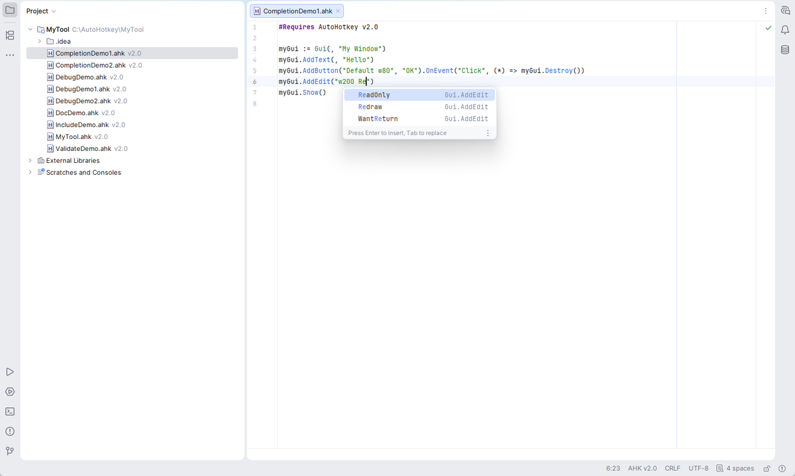
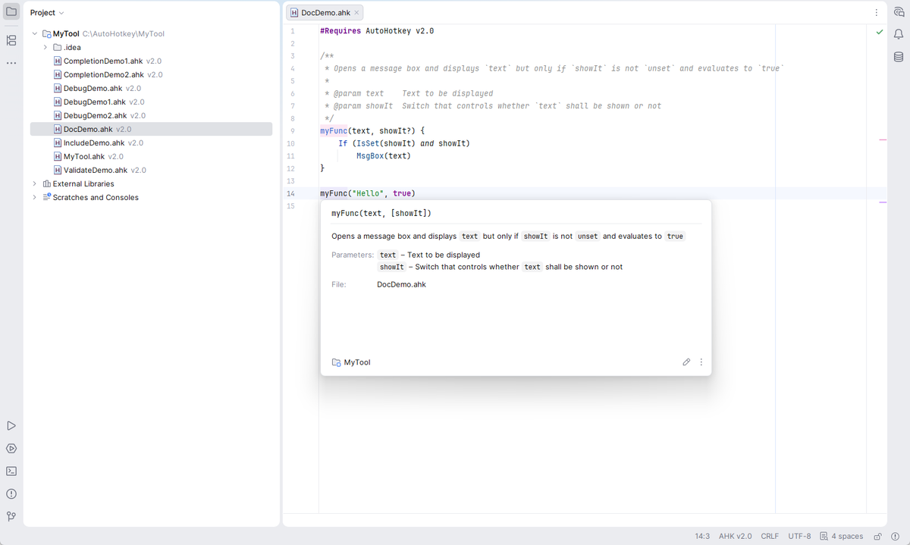
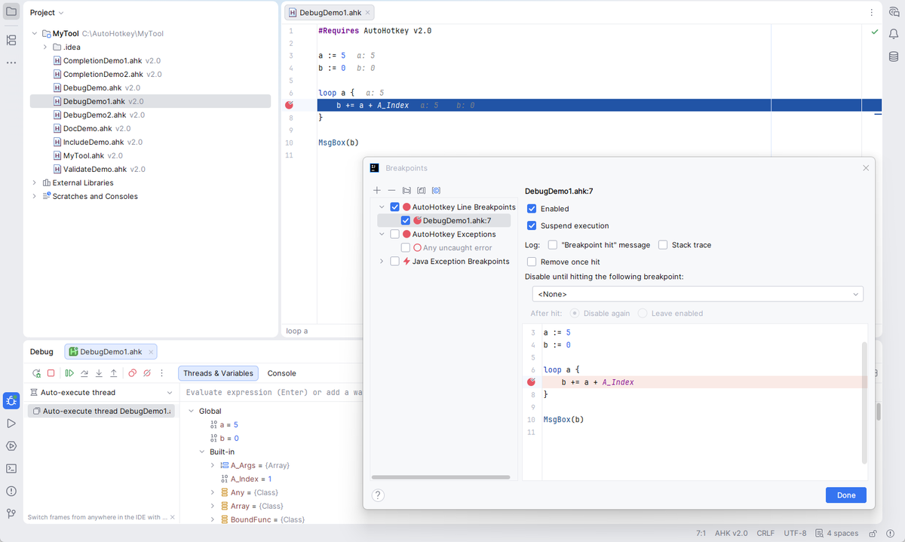

# AutoHotkey v2 Plugin for IntelliJ-based IDEs

Language support for [AutoHotkey](https://www.autohotkey.com/) **v2** scripts (`.ahk`) in IntelliJ-based IDEs.

| Completion inside option strings | Doc comments of your own code | Debugger with inline values |
|---|---|---|
|  |  |  |

More screenshots: [library completion](docs/images/include-completion.png),
[declared types](docs/images/declared-type-completion.png), [AutoHotkey help](docs/images/help-popup.png),
[validation](docs/images/validate-console.png), [doc comment formatting](docs/images/doc-comments-settings.png).

## Features

- **Parser with error highlighting** for AutoHotkey v2 syntax: expressions, commands without parentheses,
  hotkeys, hotstrings, remappings, classes, properties, `switch`, labels, continuation lines and sections.
- **Semantic highlighting** of keywords, directives, built-in variables, functions, classes, methods and
  properties, depending on the role of a name (e.g. `Length` is only colored after a dot).
- **Code formatter** with its own code style page, and optional **case adjustment** of keywords and
  built-in names when reformatting.
- **Code completion** for built-in and own names, members after the dot, directives, key names (in `Send`
  strings and hotkeys), parameter values (`CoordMode "Mouse"`), option strings (`MsgBox "YesNo Icon!"`,
  `Gui.Add("Edit", "w200 ReadOnly")`), labels after `goto`.
- **Parameter info** (Ctrl+P) for built-in functions, directives, methods and own functions.
- **AutoHotkey v2.1 (alpha, in development like v2.1 itself; v2.0 is fully supported):** files that require v2.1 get its built-in names, parameter info and help pages
  (v2.1-alpha.39); of the new v2.1 syntax so far the operators `!~=`, `??=`, `?.`, `struct`, mandatory parameters after optional ones, modules (`#Module`/`#Import` as separate namespaces for navigation, completion, Find Usages and Rename, module files in the search path), function definition expressions and typed properties (`x : Int32`, `union`).
  The level of the current file is shown in the status bar and after the file names in the Project view.
- **Go to declaration** (Ctrl+B) for functions, classes, members, base classes, labels and `#Include` files,
  also into directly included files and the AutoHotkey library folders.
- **Quick documentation** (Ctrl+Q, hover) from the AutoHotkey help and an **external help viewer** (Shift+F1).
- **Doc comments** (`/** ... */` with `@param`, `@returns`, `@see` ...) for own functions, methods and classes,
  shown as quick documentation, in the completion list and in the parameter info.
- **User manual** inside the IDE (*Help > AutoHotkey Plugin Manual*).
- **AutoHotkey help** of v2.0 and v2.1 in the *Help* menu (installed `AutoHotkey.chm`, otherwise the copy shipped
  with the plugin).
- **Type hints** with `;@declare-type` comments for better completion and parameter info.
- **Structure view, breadcrumbs, sticky lines, brace matching**, quotes and `%` typed in pairs.
- **Code folding** of blocks, comments, continuation sections, `#Include` lines and `;region` ... `;endregion`.
- **Highlighting of occurrences**: the name under the caret is highlighted throughout the file.
- **Find Usages** (Alt+F7) and **Rename** (Shift+F6, always with preview) for functions, methods, classes,
  properties, fields and labels.
- **Local variables and parameters** of functions by the scoping rules of AutoHotkey (also closures): completion,
  Ctrl+B, Find Usages, highlighting of occurrences, and rename directly in the editor.
- **Go to Symbol** (Ctrl+Alt+Shift+N) and **Go to Class** (Ctrl+N) over all AutoHotkey files of the project,
  including members, labels, hotkeys and hotstrings.
- **Spell checking** of comments, strings and hotstrings, with a dictionary of the built-in names.
- **Live templates** (functions, classes, loops, hotkeys, Gui ...), *Surround With* and a *New > AutoHotkey
  Script* file template.
- **Run configuration** with clickable load errors in the console.
- **Debugger** (work in progress) using the built-in DBGp engine of AutoHotkey v2: breakpoints, stepping, call
  stack, variables (set values, watches and hover for variables and members), inline values, exception
  breakpoint, detach and attach to a running script, `OutputDebug` in the console.
- **Validation with AutoHotkey** (`/validate`, Alt+Shift+V, optionally after *Reformat Code* or on save; validates
  the main script of the selected run configuration): the error AutoHotkey reports is marked in the code and
  shown in the console.
- **Compilation with Ahk2Exe** (*Code > Compile with Ahk2Exe*) for scripts that choose their base file with
  `;@Ahk2Exe-Base`; errors are clickable in the console. A run configuration can compile first and run the
  executable in a real console (terminal in the Run tool window or a separate console window).
- **Deploying tools** (one tool = one project, *Code > Deploy to Local Target...*): copies the tool to a fixed
  folder as described by the `settings.ahk-plugin.ini` in the project root, optionally after compiling the
  executables it copies (e.g. a GUI and a console variant). **Versions** (*Code > Set Version...*): sets
  `;@Ahk2Exe-SetVersion` in all scripts of the project, commits the project and sets the tag `v<version>`.

Only AutoHotkey v2 is supported. Files that require another version (`#Requires AutoHotkey v1.1`) are left
unparsed and only get a warning.

## Documentation

- [User guide](docs/user-guide.md): all features, settings and the comment pragmas.
- [Architecture](docs/architecture.md): how the classes work together, for developers.

## Installation

From the JetBrains Marketplace: [AutoHotkey v2 Language Support](https://plugins.jetbrains.com/plugin/36153-autohotkey-v2-language-support), or in the IDE under
*Settings > Plugins > Marketplace*, search for "AutoHotkey".

## Requirements

- An IDE based on the IntelliJ platform 2025.3 or later (IntelliJ IDEA, PyCharm, WebStorm ...); the plugin uses
  only platform modules (checked with the Plugin Verifier against IntelliJ IDEA, PyCharm and WebStorm).
- AutoHotkey v2 on Windows for running scripts and for the external help. Editing works without it.

## Building from source

The build uses Gradle with the IntelliJ Platform Gradle Plugin and Grammar-Kit. A JDK 21 is required.

```
./gradlew buildPlugin      # plugin ZIP in build/distributions/
./gradlew test             # parser and plugin tests
./gradlew runIde           # starts a sandbox IDE with the plugin
./gradlew verifyPlugin     # IntelliJ Plugin Verifier against the target IDE
./gradlew verifyPlugin -PverifyRecommendedIdes=true   # ... against all recommended IDE versions
```

The GitHub workflow `.github/workflows/build.yml` runs the tests, builds the plugin and verifies it against the
recommended IDE versions on every push and pull request (on Windows; tests that need an installed AutoHotkey are
skipped there).

Install the ZIP via *Settings > Plugins > ⚙ > Install Plugin from Disk...*.

The parser (`src/main/grammar/Ahk.bnf`) and the lexer (`src/main/grammar/Ahk.flex`) are generated into
`src/main/gen/` on every build; the generated sources are not checked in.

## Project layout

```
src/main/grammar/            Grammar (Grammar-Kit) and lexer (JFlex)
src/main/java/.../autohotkey Plugin sources, one package per feature (see docs/architecture.md)
src/main/resources/
    META-INF/plugin.xml      Plugin descriptor with all extensions
    META-INF/pluginIcon.svg  Plugin logo (shown in the plugin list and on the Marketplace)
    messages/                All texts the user sees (AhkBundle.properties)
    names/                   Name lists for highlighting, completion and parameter info (v2.1/: differences)
    help/                    AutoHotkey help (docs/, v2.0.31; v2.1/docs/, v2.1-alpha.39), own pages and manual (extra/), lookup files,
                             styles and the HTML Help project of extra.chm
    liveTemplates/           Bundled live templates
src/test/                    Tests (AhkParsingTest, AhkPluginTest)
docs/                        User guide and architecture overview
```

## License

This plugin is free software: you can redistribute it and/or modify it under the terms of the GNU General Public
License as published by the Free Software Foundation, either version 2 of the License, or (at your option) any later
version (SPDX: `GPL-2.0-or-later`). See [LICENSE](LICENSE).

The bundled AutoHotkey help pages (`src/main/resources/help/docs/`) are part of the AutoHotkey documentation and are
distributed under the GNU General Public License version 2, like AutoHotkey itself (see `help/docs/license.htm`).
The icon of the menu entries and run configurations (`src/main/resources/icons/autohotkey-action*.png`) is the program icon of
`AutoHotkey64.exe` and is distributed under the same license.
